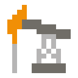
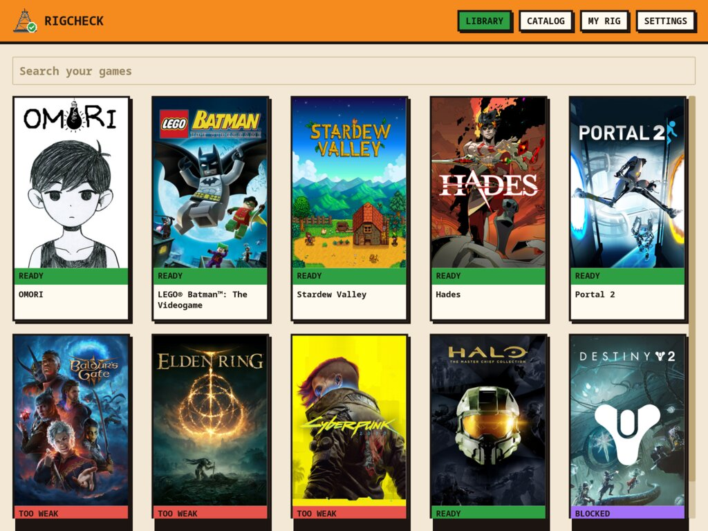
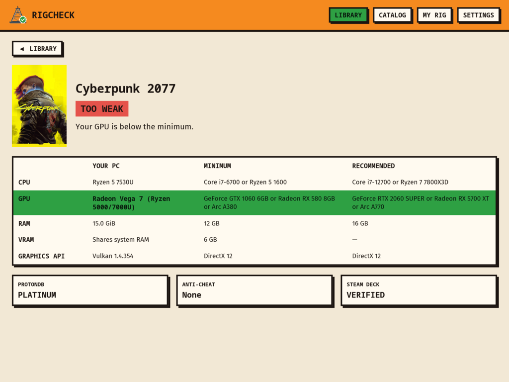
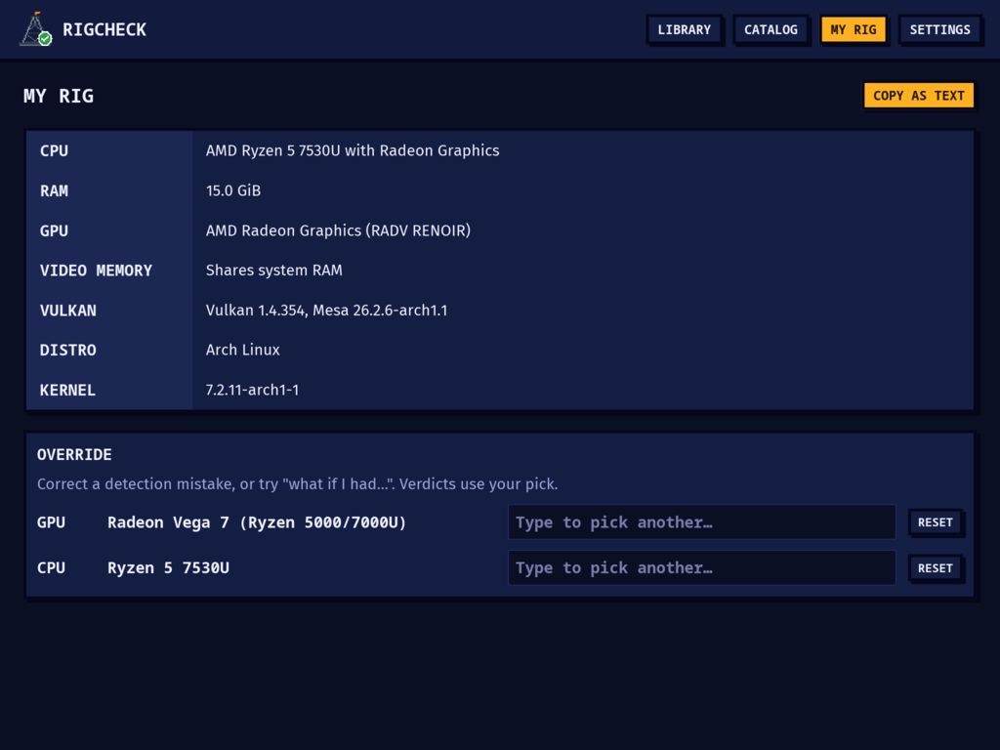
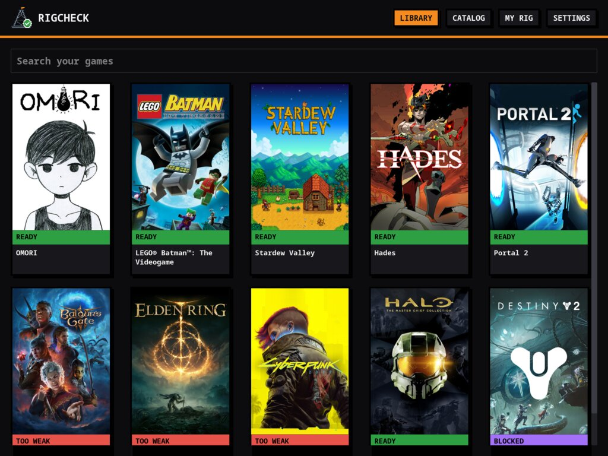
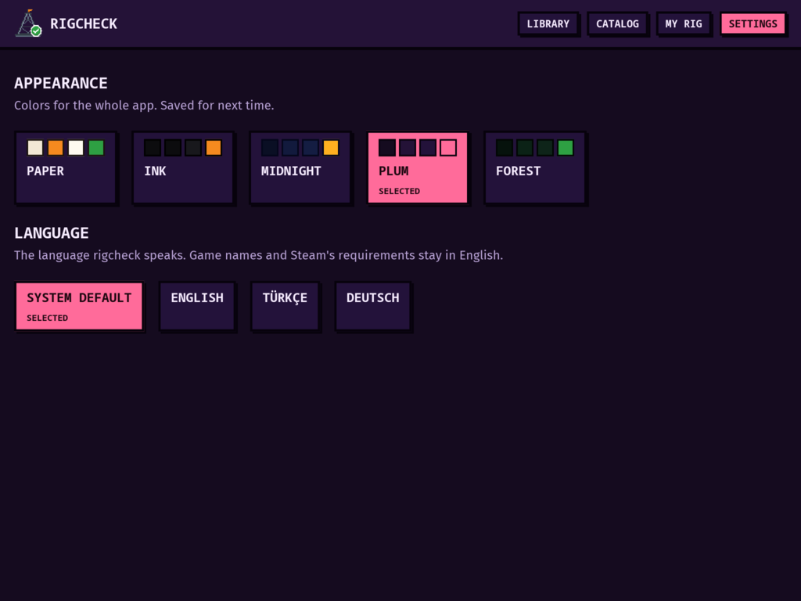

<p align="center">
  
</p>

<h1 align="center">rigcheck</h1>

<p align="center">
  <b>Can my PC run it?</b><br>
  A Linux desktop app that checks your Steam games against your hardware, and against Linux itself.
</p>

<p align="center">
  
</p>

> [!NOTE]
> **Early development.** The Library, game page and hardware detection work today, using a small built-in database of 22 games. The full Steam catalog arrives with the data pipeline. See the [roadmap](ROADMAP.md).

## What it does

- **Reads your Steam library.** It finds native, `~/.steam` and Flatpak installs and every library folder, including other drives, and skips Proton and the Steam runtimes.
- **Detects your hardware.** It reads CPU, RAM, every GPU by its PCI ID, video memory, the Vulkan version and the driver straight from `/proc`, `/sys` and `vulkaninfo`. Hybrid laptops use the discrete GPU, and it warns if your NVIDIA card runs on `nouveau`.
- **Gives every game a verdict.** It compares your PC with the game's minimum and recommended specs, names the part holding you back, and takes Linux into account: ProtonDB ratings, anti-cheat that blocks Linux, and the Vulkan version Proton needs.
- **Lets you ask "what if?"** Pick a different GPU or CPU on My Rig and every verdict updates.

| Stamp | Meaning |
|---|---|
| `READY` | Meets the recommended specs |
| `LOW` | Meets the minimum; at least one part falls short of recommended |
| `TOO WEAK` | At least one part is below the minimum, and the game page says which |
| `BLOCKED` | Can't run on Linux whatever the hardware, e.g. anti-cheat that denies Linux |
| `???` | Not enough data to say |

## Screenshots

<table>
  <tr>
    <td></td>
    <td></td>
  </tr>
  <tr>
    <td align="center">Why a game won't run, part by part</td>
    <td align="center">Your hardware, with "what if I had…" overrides</td>
  </tr>
  <tr>
    <td></td>
    <td></td>
  </tr>
  <tr>
    <td align="center">Five themes: Paper, Ink, Midnight, Plum, Forest</td>
    <td align="center">English, Türkçe and Deutsch</td>
  </tr>
</table>

<sub>Screenshots from the real app, rendered offscreen with its test renderer on a Ryzen 5 7530U laptop with Radeon integrated graphics.</sub>

## Privacy

Local-first: no accounts, no telemetry, no servers. Everything stays on your machine.

Today the app makes **no network requests at all**. Cover art comes from Steam's own cache on disk. Later versions will talk to exactly three read-only places, listed in [ROADMAP §6](ROADMAP.md#6-privacy--network): GitHub Releases for the game database, Steam's store API for games missing from it, and Steam's image CDN. A build rule (`deny.toml`) keeps HTTP clients out of every crate except one.

## Build from source

Arch is shown; any distro with `rustup` works. No GUI packages are needed to build, since iced loads Wayland, X11 and Vulkan at runtime.

```sh
sudo pacman -S --needed rustup base-devel
rustup default stable            # includes clippy and rustfmt
git clone https://github.com/Glory42/rigcheck && cd rigcheck
cargo run -p rigcheck --release
```

Install `vulkan-tools` too, so rigcheck can read your GPU's Vulkan details.

## Development

All Rust: a Cargo workspace with the desktop app (built with [iced](https://iced.rs)), the data pipeline and shared crates. The code is built test-first.

```
app/          desktop app: Library, game page, My Rig, Settings (binary: rigcheck)
  i18n/       translations (Fluent): en, tr, de
crates/
  core/       requirement parser, hardware table matching, matcher (no I/O)
  hardware/   Linux hardware detection
  steam/      Steam installs, libraries and cover art
  gamedb/     games.db (SQLite): schema, seed, queries, verdicts
  net/        the only crate allowed an HTTP client (unused so far)
pipeline/     data pipeline that builds games.db (Phase 4)
data/         hardware table, seed games, test fixtures
```

```sh
cargo install cargo-deny --locked
cargo test --workspace           # all tests; UI tests run headless
cargo clippy --workspace --all-targets -- -D warnings
cargo fmt --all
cargo deny check bans            # only crates/net may use an HTTP client
INSTA_UPDATE=always cargo test -p rigcheck-core --test parser   # accept parser snapshot changes, then review the diff
```

CI runs fmt, clippy, tests and `cargo deny` on pushes to `master` and on pull requests.

## Credits

- Requirement text in `data/fixtures/requirements/` comes from Steam's store pages, for testing the parser.
- Hardware scores in `data/hardware.toml` are rough hand estimates until the pipeline brings in benchmark data.
- The pixel-art icon is original, drawn by scripts in [`assets/brand/`](assets/brand/).

## License

Code: [MIT](LICENSE).
