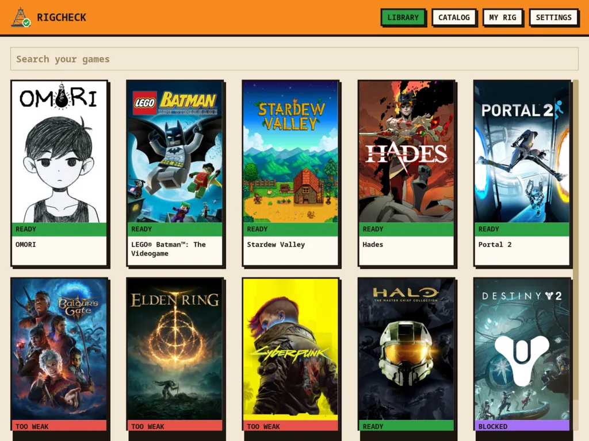
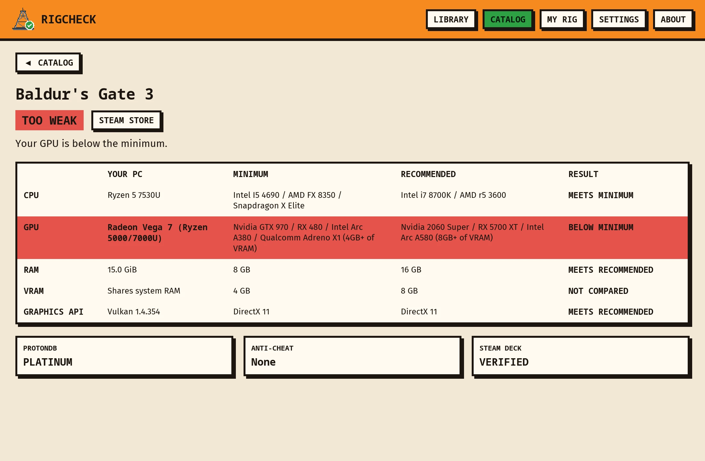
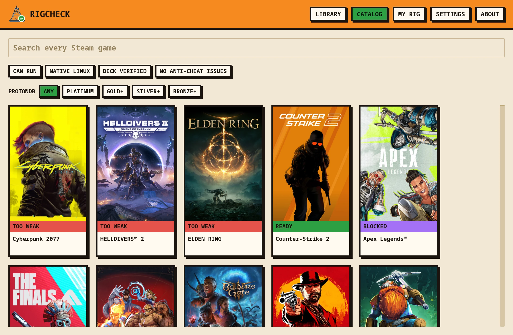
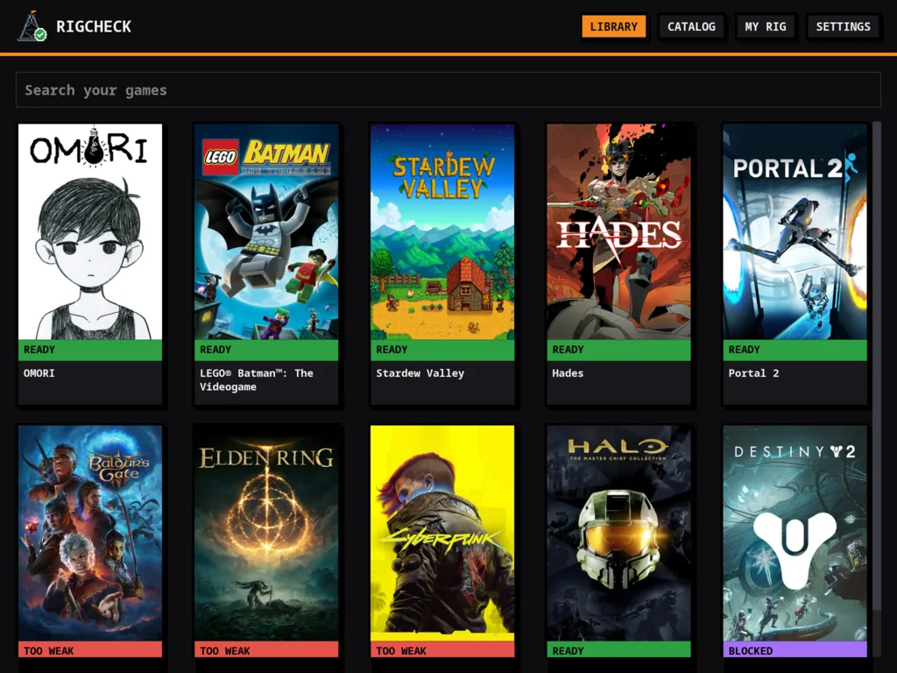
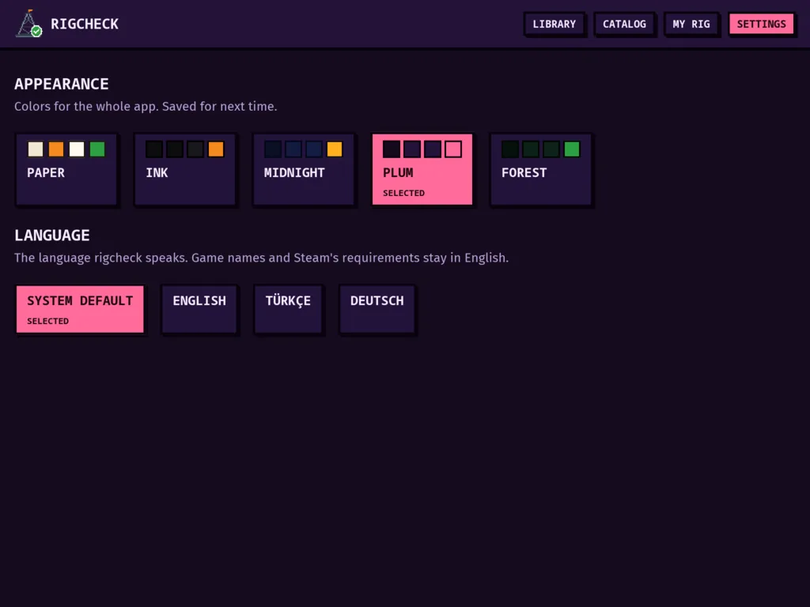
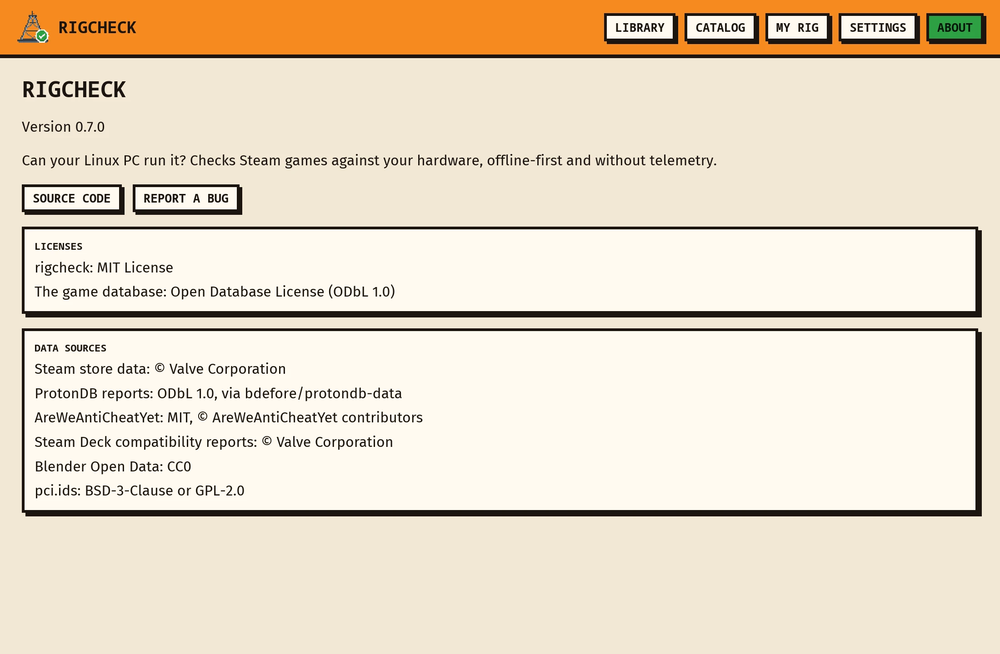

<p align="center">
  
</p>

<h1 align="center">rigcheck</h1>

<p align="center">
  <b>Can my PC run it?</b><br>
  A Linux desktop app that checks your Steam games against your hardware, and against Linux itself.
</p>

<p align="center">
  
</p>

> [!NOTE]
> **v1.0.** The game database is rebuilt daily from Steam; its store pages are read a few thousand a day, so many of Steam's ~200k games are known by name only for now, and get looked up live when you open them. See the [roadmap](ROADMAP.md).

## What it does

- **Reads your Steam library.** It finds native, `~/.steam` and Flatpak installs and every library folder, including other drives, and skips Proton and the Steam runtimes. Add your own Steam Web API key in Settings and the Library can show every game you own, installed or not.
- **Detects your hardware.** It reads CPU, RAM, every GPU by its PCI ID, video memory, the Vulkan version and the driver straight from `/proc`, `/sys` and `vulkaninfo`. Hybrid laptops use the discrete GPU, and it warns if your NVIDIA card runs on `nouveau`.
- **Gives every game a verdict.** It compares your PC with the game's minimum and recommended specs, names the part holding you back, and takes Linux into account: ProtonDB ratings, anti-cheat that blocks Linux, and the Vulkan version Proton needs.
- **Searches all of Steam.** The Catalog lists every game, most popular first, and filters it: only games your PC can run, ProtonDB tier, native Linux, Deck Verified, no anti-cheat problems. A game the database hasn't checked yet is looked up on Steam when you open it.
- **Lets you ask "what if?"** Pick a different GPU or CPU on My Rig and every verdict updates.
- **Keeps itself current.** The game database updates in the background, and the app tells you when a new version is out.

| Stamp | Meaning |
|---|---|
| `READY` | Meets the recommended specs |
| `LOW` | Meets the minimum; at least one part falls short of recommended |
| `TOO WEAK` | At least one part is below the minimum, and the game page says which |
| `BLOCKED` | Can't run on Linux whatever the hardware, e.g. anti-cheat that denies Linux |
| `???` | Not enough data to say |

## Screenshots

<table>
  <tr>
    <td></td>
    <td></td>
  </tr>
  <tr>
    <td align="center">Why a game won't run, part by part</td>
    <td align="center">Every Steam game, searchable and filterable</td>
  </tr>
  <tr>
    <td></td>
    <td></td>
  </tr>
  <tr>
    <td align="center">Your hardware, with "what if I had…" overrides</td>
    <td align="center">Five themes: Paper, Ink, Midnight, Plum, Forest</td>
  </tr>
  <tr>
    <td></td>
    <td></td>
  </tr>
  <tr>
    <td align="center">English, Türkçe, Deutsch; what's stored and how to clear it</td>
    <td align="center">Licenses and data sources</td>
  </tr>
</table>

<sub>Screenshots from the real app on the real game database, rendered offscreen with its test renderer on a Ryzen 5 7530U laptop with Radeon integrated graphics (`app/src/screenshots.rs`).</sub>

## Privacy

Local-first: no accounts, no telemetry, no servers of our own. Nothing about you or your PC leaves your machine.

The app sends plain, read-only requests to three places (four if you add a Steam key), and nowhere else ([ROADMAP §6](ROADMAP.md#6-privacy--network)):

| Where | When | What's sent |
|---|---|---|
| `github.com` (Releases) | At start: is there a newer game database, or a newer rigcheck? Downloads the database when there is | Nothing but the file request |
| `store.steampowered.com` | When you open a game the database hasn't checked yet | That game's app ID |
| `shared.akamai.steamstatic.com` | Cover art Steam hasn't cached on your disk | The game's app ID |
| `api.steampowered.com` | Only if you add your own Steam Web API key: at start and on Refresh, to list the games you own | Your key and SteamID |

Settings → Privacy turns the start-up checks off (then they run only when you ask), and lists the same three places. A build rule (`deny.toml`) keeps HTTP clients out of every crate except `crates/net`, which refuses any other host.

## Install

Each [release](https://github.com/Glory42/rigcheck/releases) has an **AppImage** (any distro), a **.deb** (Debian, Ubuntu, Mint), an **.rpm** (Fedora, openSUSE) and a tarball. AUR packages (`rigcheck-bin` for releases, `rigcheck-git` for the latest `master`) and a Flathub listing are on the way; their recipes are in [`packaging/`](packaging/).

Install `vulkan-tools` as well, so rigcheck can read your GPU's Vulkan version and video memory.

## Build from source

Arch is shown; any distro with `rustup` works. No GUI packages are needed to build, since iced loads Wayland, X11 and Vulkan at runtime.

```sh
sudo pacman -S --needed rustup base-devel
rustup default stable            # includes clippy and rustfmt
git clone https://github.com/Glory42/rigcheck && cd rigcheck
cargo run -p rigcheck --release
```

## Development

All Rust: a Cargo workspace with the desktop app (built with [iced](https://iced.rs)), the data pipeline and shared crates. The code is built test-first.

```
app/          desktop app: Library, Catalog, game page, My Rig, Settings, About (binary: rigcheck)
  i18n/       translations (Fluent): en, tr, de
crates/
  core/       requirement parser, hardware table matching, matcher (no I/O)
  hardware/   Linux hardware detection
  steam/      Steam installs, libraries and cover art
  gamedb/     games.db and fetched.db (SQLite): schema, queries, verdicts, safe install
  net/        the only crate allowed an HTTP client; refuses hosts off its allowlist
pipeline/     data pipeline that builds games.db daily (GitHub Actions)
packaging/    desktop file, AppStream metainfo, AppImage/deb/rpm, AUR and Flatpak recipes
data/         hardware table, seed games, test fixtures
```

```sh
cargo install cargo-deny --locked
cargo test --workspace           # all tests; UI tests run headless
cargo clippy --workspace --all-targets -- -D warnings
cargo fmt --all
cargo deny check bans            # only crates/net may use an HTTP client
INSTA_UPDATE=always cargo test -p rigcheck-core --test parser   # accept parser snapshot changes, then review the diff
```

CI runs fmt, clippy, tests and `cargo deny` on pushes to `master` and on pull requests. Screenshots are rendered by an ignored test: `RIGCHECK_SCREENSHOT_DB=<a games.db> cargo test -p rigcheck screenshots -- --ignored`.

## Contributing

Wrong verdicts, missing hardware, translations and captures of your machine all help. [CONTRIBUTING.md](CONTRIBUTING.md) explains each, plus how code gets written here (test-first). Please follow the [Code of Conduct](CODE_OF_CONDUCT.md), and report security problems privately as described in [SECURITY.md](SECURITY.md).

## Credits

- Game data comes from Steam's store pages; Proton compatibility from [ProtonDB](https://www.protondb.com) reports ([ODbL](https://opendatacommons.org/licenses/odbl/1-0/)), rated by rigcheck's own rule ([ROADMAP §9](ROADMAP.md#9-data-sources--licenses)); anti-cheat status from [AreWeAntiCheatYet](https://areweanticheatyet.com) (MIT); Steam Deck status from Steam's Deck compatibility reports.
- Requirement text in `data/fixtures/requirements/` comes from Steam's store pages, for testing the parser.
- Hardware scores in `data/hardware.toml` are rough hand estimates. The published database fills in parts the table lacks from [Blender Open Data](https://opendata.blender.org) (CC0), and GPU PCI IDs come from [pci.ids](https://pci-ids.ucw.cz).
- The pixel-art icon is original, drawn by scripts in [`assets/brand/`](assets/brand/).

## License

Code: [MIT](LICENSE). The published game database (`games.db`) includes ProtonDB data, so it's under the [ODbL](https://opendatacommons.org/licenses/odbl/1-0/).
